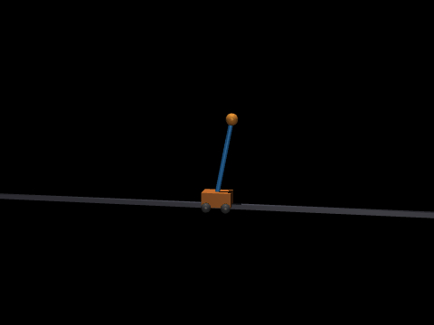
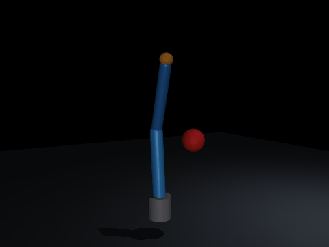
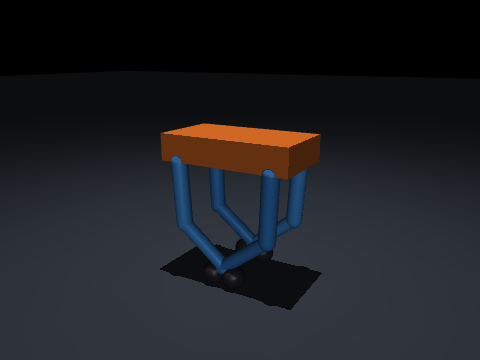
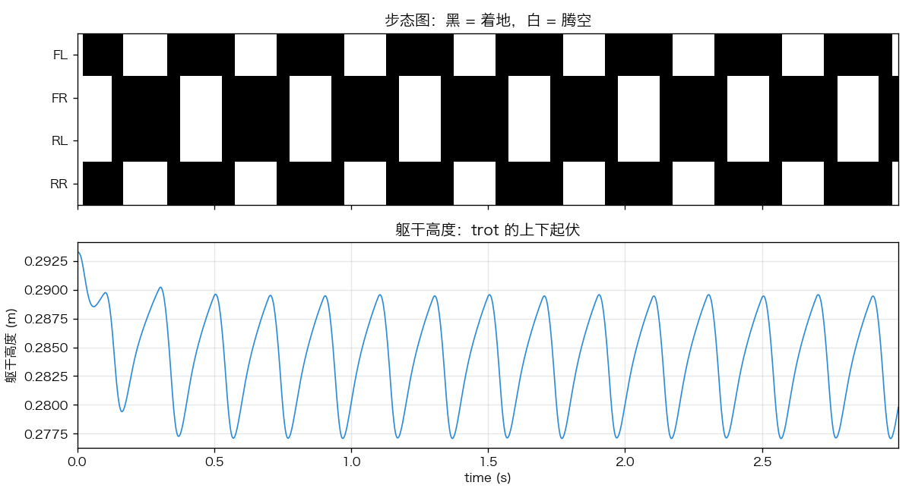
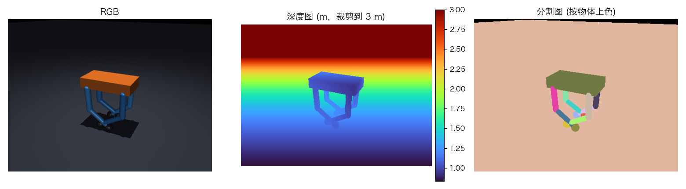
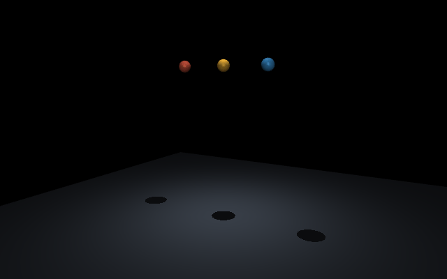

# MuJoCo Lab · 从零手玩物理引擎

一个**能在你这台 Mac 上 30 秒内全部跑通**的 MuJoCo 入门项目：
7 节递进式实操课 + 1 个交互式 playground，每节课都有可打印的数据、可看的曲线和 GIF 录屏。

- 依赖极少：`mujoco` + `numpy` + `Pillow`（可选 `matplotlib` / `scipy`）
- 不用 GPU、不用训练、不用联网
- 所有代码都写成"能读懂的教程"，中文注释里解释每个 API 为什么这么用
- 全程 GPU 无关：渲染走 MuJoCo 自带的离屏 GL，Apple Silicon 上可直接用

> 仓库：<https://github.com/hhhqqq2003/mujoco-lab> · 环境：macOS 14 (Apple Silicon) / Python 3.14 / MuJoCo 3.17

---

## 效果预览

| 小车倒立摆 LQR（第 4 课） | 机械臂逆运动学（第 5 课） |
|---|---|
|  |  |

| 四足 trot 步态（第 6 课） | 步态图 + 躯干高度（第 6 课） |
|---|---|
|  |  |

| 深度图 / 分割图（第 9 课） | 空气阻力三球对比（练习 02b） |
|---|---|
|  |  |

---

## 快速开始

```bash
git clone https://github.com/hhhqqq2003/mujoco-lab.git
cd mujoco-lab
python3 -m pip install --user -r requirements.txt   # 安装依赖（mujoco/numpy/pillow 等）

python3 check_env.py     # 1. 先自检：版本 / 渲染 / 可选依赖
python3 01_model_and_data.py
python3 02_physics_intuition.py
...                      # 一直到 07
python3 08_play.py       # 8. 打开交互窗口（需要桌面环境）
python3 09_visualize.py  # 9. 可视化手册：一次生成 6 张演示图/GIF
python3 view_xml.py      # 10. 改 XML 后立刻开窗看效果（看默认 01_model.xml）
```

偷懒版（一条命令跑完全部课程并汇总耗时）：

```bash
python3 run_all.py          # 约 22 秒
python3 run_all.py 3 4      # 只跑第 3、4 课
```

所有图片 / GIF 产物都在 `out/`，双击即可查看。

---

## 课程地图

| # | 文件 | 学什么 | 关键 API / 概念 | 产物 |
|---|------|--------|----------------|------|
| 01 | `01_model_and_data.py`<br>`01_model.xml` | 分清 `MjModel`（蓝图）和 `MjData`（状态）；qpos/qvel/ctrl/sensordata 的布局；自由关节为什么 nq≠nv | `model.joint(i)`、`mj_id2name`、`mj_forward` vs `mj_step`、`data.ncon`、`mj_contactForce` | 终端报告 |
| 02 | `02_physics_intuition.py`<br>`ex_02a_damping.py`<br>`ex_02b_air_drag.py`<br>`ex_02c_damper_actuator.py` | 时间步与积分器怎么影响精度；MuJoCo 没有 restitution，弹性来自接触模型；接触刚度必须匹配 dt；**阻尼让能量单调指数衰减** | `mjENBL_ENERGY`、`data.energy`、`solref`/`solimp`、`mjtIntegrator`、`dof_damping` | `02_integrator_and_contact.png`<br>`02_bouncing_ball.gif`<br>`ex_02a_damping.png` |
| 03 | `03_pendulum_pd.py` | 执行器与 PD 控制回路；控制频率 ≠ 物理步长；稳态误差从哪来；重力前馈；**幽灵接触的排查** | `data.ctrl`、`motor`/`position` 执行器、`data.qfrc_bias`、`contype`/`conaffinity` | `03_pendulum_pd.png`<br>`03_pendulum_pd.gif` |
| 04 | `04_cartpole_lqr.py` | 不用手推动力学：有限差分拿 A/B → 解 Riccati → LQR 稳定倒立摆并抗扰动 | `mjd_transitionFD`、`scipy.linalg.solve_continuous_are`、闭环极点 | `04_cartpole_lqr.png`<br>`04_cartpole_lqr.gif` |
| 05 | `05_arm_ik.py` | 机械臂逆运动学：雅可比 + 阻尼最小二乘；mocap 目标点；任务空间 vs 关节空间 | `mj_jacSite`、DLS 伪逆、`mj_forward`、`<compiler angle="radian">` | `05_arm_ik.png`<br>`05_arm_ik.gif` |
| 06 | `06_quadruped_gait.py` | 手搓 8 自由度四足；镜像膝关节；相位生成 trot 步态；从 `data.contact` 画步态图 | 相位步态、`data.contact`、占空比/支撑相、重心与支撑多边形 | `06_gait_diagram.png`<br>`06_quadruped_trot.gif` |
| 07 | `07_cem_learning.py` | 用 CEM（无梯度优化）从零学出倒立摆增益，并与 LQR 对比样本效率 | 参数化策略、rollout 代价、参数缩放、model-free vs model-based | `07_cem_learning.png`<br>`07_cem_cartpole.gif` |
| 08 | `08_play.py` | 交互式窗口：拖动/旋转/暂停，四个场景随时切换 | `mujoco.viewer.launch_passive`、实时 pacing | 实时窗口 |
| 09 | `09_visualize.py` | **可视化手册**：单帧/多机位/跟踪相机/深度图/分割图/接触力/第一人称视角 | `Renderer`、`MjvCamera`、`MjvOption`、深度+分割渲染、`MjSpec.add_camera` | `09_*.png` / `09_*.gif` |

---

## 怎么可视化（四种方式，按需要选）

### ① 实时交互窗口（最直观）

```bash
python3 08_play.py            # 菜单选 4 个场景之一
python3 09_visualize.py --viewer   # 四足 + 接触力/关节/质心全开
```

必须在你自己的**桌面 Terminal** 里跑（不是在后台/SSH 里）。

> **macOS 必读**：MuJoCo 的 `launch_passive` 在 macOS 上**必须由 `mjpython` 启动**，
> 用 `python3` 会报 `RuntimeError: launch_passive requires that the Python script be run under mjpython`。
> 本项目已经内置自动切换：直接 `python3 09_visualize.py --viewer` 即可，脚本检测到 macOS
> 会用 `mjpython` 把自己重启一遍。也可以手动跑：
>
> ```bash
> mjpython 09_visualize.py --viewer
> ```
>
> 如果提示 `mjpython: command not found`，说明它不在 PATH（`--user` 安装时很常见）：
>
> ```bash
> echo 'export PATH="$HOME/Library/Python/3.14/bin:$PATH"' >> ~/.zshrc && source ~/.zshrc
> # 或者直接用完整路径
> ~/Library/Python/3.14/bin/mjpython 09_visualize.py --viewer
> ```

操作方式：

| 操作 | 效果 |
|---|---|
| 左键拖动 | 旋转视角 |
| 右键拖动 | 平移 |
| 滚轮 | 缩放 |
| 双击物体 | 选中并查看局部坐标 |
| 空格 | 暂停 / 继续 |
| 左侧 UI | 可视化开关（接触点、接触力、关节、质心、帧率…） |
| 右侧 UI | 积分器、求解器、实时倍率 |

代码里也能直接改视图：`with mujoco.viewer.launch_passive(model, data) as v:` 之后
`v.cam`（相机）、`v.opt`（可视化开关）都是可写的。

### ② 离屏渲染成图片 / GIF（后台也能跑，本项目的默认方式）

```python
import mujoco, common

renderer = mujoco.Renderer(model, height=480, width=640)
renderer.update_scene(data, camera=-1)      # -1 = 自由相机
pixels = renderer.render()                  # numpy (h, w, 3) uint8

common.save_png(pixels, "frame")            # 单帧 → out/frame.png
frames = common.render_frames(model, data, n_frames=100, steps_per_frame=20,
                              camera=common.make_camera(azimuth=120, elevation=-15))
common.save_gif(frames, "demo", fps=30)     # 帧序列 → out/demo.gif
```

`python3 09_visualize.py` 会一次生成：单帧、四机位拼图、跟踪相机 GIF、深度/分割图、接触力近景、第一人称 GIF。

### ③ 告诉相机看哪里（`MjvCamera` 只有 4 个参数）

| 参数 | 含义 |
|---|---|
| `azimuth` | 水平角（度） |
| `elevation` | 俯仰角（度），负数=从上往下看 |
| `distance` | 距离 |
| `lookat` | 注视点 `[x, y, z]` |

三种相机类型：
- **自由相机**：`camera=-1`，就用上面的 `MjvCamera`
- **跟踪相机**：`cam.type = mjCAMERA_TRACKING; cam.trackbodyid = mujoco.mj_name2id(model, mjOBJ_BODY, "torso")` → 镜头跟着机器人走
- **模型自带相机**：在 MJCF 里写 `<camera name="..." pos="..." quat="..."/>`，或者用 `MjSpec` 运行时加（第 9 课 E 节演示了给躯干装"眼睛"）
  注意：MuJoCo 相机默认看向自己的 **-z** 方向，所以"朝前看"要旋转 90°；第 9 课给了 `look_quat(方向)` 工具函数。

### ④ 叠加层 / 传感器图（排查问题的利器）

```python
opt = common.vis_option(contact_point=True, contact_force=True, joint=True, com=True)
frame = common.render_once(model, data, camera=cam, scene_option=opt)

renderer.enable_depth_rendering();        depth = renderer.render()  # 每个像素的距离 (m)
renderer.enable_segmentation_rendering(); seg   = renderer.render()  # (物体 id, 物体类型)
```

- **接触点 / 接触力**：看力从哪来、有没有幽灵接触
- **深度图 / 分割图**：做视觉 RL、点云重建时的"免费真值标签"
- **关节/质心/惯量**：检查模型建得对不对

### ⑤ 在 Jupyter / ipython 里内嵌

```python
import io, base64, mujoco
from IPython.display import HTML, display
from PIL import Image

r = mujoco.Renderer(model, 240, 320)
r.update_scene(data, camera=-1)
buf = io.BytesIO(); Image.fromarray(r.render()).save(buf, format="PNG")
display(HTML('' % base64.b64encode(buf.getvalue()).decode()))
```

### ⑥ 看 / 改自己的 XML（`view_xml.py`）

学 MuJoCo 最快的工作流：**编辑 XML → 保存 → 开窗看**，不用写 Python：

```bash
python3 view_xml.py                 # 看默认的 01_model.xml（第 1 课的模型）
python3 view_xml.py my_robot.xml    # 看任意 MJCF 文件
python3 view_xml.py my_robot.xml --info      # 不渲染，只打印模型结构（XML 元素 ↔ 字段）
python3 view_xml.py my_robot.xml --png       # 存一张截图（不用开窗）
python3 view_xml.py my_robot.xml --gif 4     # 录 4 秒 GIF（不用开窗）
python3 view_xml.py my_robot.xml --contacts  # 开窗并显示接触点/接触力/关节/质心
python3 view_xml.py my_robot.xml --contacts --png --t 1  # 先仿真 1s 再出图（能看到落地接触点）
python3 view_xml.py my_robot.xml --no-physics # 只看静态模型
python3 view_xml.py my_robot.xml --az 90 --el -30 --dist 2   # 手动指定相机
```

- 相机默认**自动取景**（按几何体包围盒算，跳过无限大的 plane）
- 改完 XML 直接重跑同一个命令即可；XML 写错时 MuJoCo 会报**行号 + 元素名**，按行号改
- `--info` 是学 XML 的最佳工具：它把 `<body>/<joint>/<geom>/<actuator>/<sensor>` 一一对应到
  `model.nbody`、`model.joint(i).qposadr` 等字段上

第 1 课的模型已经抽成独立文件 **`01_model.xml`**，你可以：
1. 改 `<option timestep="0.002">` 里的数值 → `python3 01_model_and_data.py` 看数值影响
2. 改 `<body name="box" pos="0 0 1.5">` 的高度 → `python3 view_xml.py` 看视觉变化
3. 改 `<position ... kp="8">` 的增益 → `python3 01_model_and_data.py --viewer` 看门摆得更快还是更抖

**新手改 XML 最容易踩的 5 个坑**

| 报错/现象 | 原因 |
|---|---|
| `repeated name "xxx"` | 同一类元素里 `name` 重复（name 要全局唯一到类别内） |
| `unrecognized attribute: 'xxx'` | 属性名拼错，或该属性不属于这个元素（比如 geom 没有 `restitution`） |
| `XML Error: invalid keyword` | 枚举值写错，如 integrator 要写 `Euler`/`RK4`/`implicitfast` |
| `unknown name 'xxx'` | 引用了不存在的名字（如 actuator 写了不存在的 joint） |
| 关节几乎不动 / 卡死 | `range` 默认单位是**度**，写弧度要 `<compiler angle="radian"/>`；或几何体重叠产生幽灵接触 |

> 想要 **mp4** 而不是 GIF：`pip install --user "imageio[ffmpeg]"`，再 `imageio.mimsave("x.mp4", frames, fps=30)`。
> MuJoCo 自带的 viewer 不支持一键录屏，所以录制统一走"离屏渲染 → 存帧"这条路。

## 真正踩过的坑（都写进代码注释了）

1. **MJCF 默认角度单位是「度」**，不是弧度。`range="-2.6 2.6"` 会被编译成 ±2.6°，关节几乎锁死。
   写弧度必须加 `<compiler angle="radian"/>`（第 5 课）。
2. **装饰性几何体忘了关碰撞**：支架球/柱和运动部件重叠 → 生成一个"幽灵接触"，把关节卡死（`data.qfrc_constraint` 爆增）。
   修法：`contype="0" conaffinity="0"`，排查：`print(data.ncon)`（第 3 课）。
3. **`mjd_transitionFD` 不支持 RK4 积分器**，会直接 `FatalError`；做线性化时用 `implicitfast`/`Euler`（第 4 课）。
4. **`mj_jacSite` 依赖 `mj_forward` 的中间量**：只调 `mj_kinematics` 拿到的雅可比是全零，IK 会原地不动（第 5 课）。
5. **四足前后腿的膝轴必须镜像**，否则四条腿的支撑多边形整体偏移，站都站不住（第 6 课）。
6. **trot 对重心极其敏感**：给躯干前端加 50 g 装饰都能让动态步态崩掉（第 6 课有对照实验）。
7. **`mujoco.viewer` 不是顶层属性**，必须 `import mujoco.viewer`（第 8 课）。
8. **CEM 直接搜增益 K 学不动**：摆角增益要到 −40 量级，得先做参数缩放 `K = z · SCALES`（第 7 课）。
9. `data.qpos` 里自由关节是 `[x, y, z, qw, qx, qy, qz]` —— 4 个数只贡献 3 个转动自由度，所以 nq > nv（第 1 课）。
10. 版本差异：MuJoCo 里 **没有 `restitution` 属性**，弹性是 `solref` 阻尼比的涌现行为（第 2 课）。

---

## 建议的三天学习路线

**第 1 天：看懂引擎**
`check_env.py` → `01` → `02`。目标：随口说清 `MjModel`/`MjData` 的区别、`mj_step` 里发生了什么、dt 和积分器怎么选。

**第 2 天：做控制**
`03` → `04`。目标：能自己写一个 PD 回路；理解"前馈 + 反馈"和"LQR 是二次型最优"。

**第 3 天：碰真实机器人问题**
`05` → `06` → `07`。目标：知道 IK 为什么要阻尼；知道步态是相位问题；知道 CEM/RL 与 model-based 控制的取舍。

每节课末尾都有 3 个**练习题**（改参数看变化），动手做完比读十遍有用。

---

## 常见问题

**Q: 没有窗口 / 在后台跑，`08_play.py` 报错？**
A: 正常。交互窗口需要桌面环境；其余所有课程的 GIF 和曲线都不受影响。要在你桌面的 Terminal 里跑 `python3 08_play.py`。

**Q: macOS 上报 `launch_passive requires ... mjpython`？**
A: 这是 MuJoCo 的硬性要求：交互窗口必须用 `mjpython` 启动（`python3` 不行）。
第 8、9 课已经做了自动切换，直接 `python3 08_play.py` / `python3 09_visualize.py --viewer` 即可；
想手动跑就用 `mjpython 08_play.py`。`mjpython` 不在 PATH 时用完整路径
`~/Library/Python/3.14/bin/mjpython`（版本号按你的 Python 改）。

**Q: GIF 在 Finder 里不打动？**
A: 用浏览器打开（拖进 Safari/Chrome），或者 `open out/xxx.gif`。

**Q: 想改模型但不想动代码？**
A: 每节课的 `XML` 字符串就是完整的 MJCF 模型，直接改数值重跑即可。想看某个数值是谁：第 1 课教你遍历 `model.*`。

**Q: 第 6 课为什么不让它走路？**
A: 这 8 自由度模型的腿只有 pitch，对 yaw/roll 没有控制力，开环往前走 1 秒内必然偏航摔倒（代码里打印了实测）。
真要走起来需要每腿加外摆关节 + IMU 反馈，或直接上 RL —— 作为下一阶段的练习。

---

## 下一步（等这些都玩熟了）

| 方向 | 包 / 工具 | 说明 |
|------|-----------|------|
| 现成 RL 环境 | `pip install --user "gymnasium[mujoco]"` | `Ant-v5`/`Humanoid-v5`，配 Stable-Baselines3 跑 PPO |
| 官方 RL 示例 | `pip install --user dm_control` | DeepMind 的 MuJoCo 任务集（含控制套件） |
| 超高速仿真 | MJX（JAX 版 MuJoCo） | 在 Apple Silicon 上用 CPU/GPU 并行几万个环境，适合大模型 RL |
| 机器人建模 | 自己的 MJCF / URDF 导入 | `mujoco` 自带 `MjSpec` 可在运行时改模型；URDF 用 `mujoco` 的 `mj_loadXML` 转换 |
| 学真机 | ROS2 + MuJoCo | 用 MuJoCo 做数字孪生再上真机 |

> 本项目的 7 节课覆盖了上面所有方向的**共同前置**：模型/数据、接触、执行器、控制回路、线性化、IK、步态、优化。
> 学完再去看 Gymnasium / dm_control 的源码，你会发现只是换了封装。

---

## 目录结构

```
mujoco-lab/
├── check_env.py             环境自检
├── common.py                渲染 / GIF / viewer / 中文字体 工具
├── run_all.py               一键跑全部课程
├── 01_model.xml             第 1 课的模型（可以直接编辑）
├── 01_model_and_data.py
├── 02_physics_intuition.py
├── 03_pendulum_pd.py
├── 04_cartpole_lqr.py
├── 05_arm_ik.py
├── 06_quadruped_gait.py
├── 07_cem_learning.py
├── 08_play.py               交互式 playground
├── 09_visualize.py          可视化手册（出图/GIF/深度/分割/FPV）
├── view_xml.py              通用 XML 查看器（改完 XML 立刻看）
├── ex_02a_damping.py        练习 02(a) 的完整解答：加阻尼后能量怎么变
├── ex_02b_air_drag.py       练习 02(b) 的完整解答：给小球加空气阻力（三种做法）
├── ex_02c_damper_actuator.py 练习 02(c)：用 <damper> 执行器 + actuator_dampingpoly 做阻力
├── docs/                    说明文档用的演示图（README 里引用）
├── requirements.txt         依赖清单
├── LICENSE                  MIT
└── out/                     所有图片和 GIF 产物（运行后生成，已 gitignore）
```
